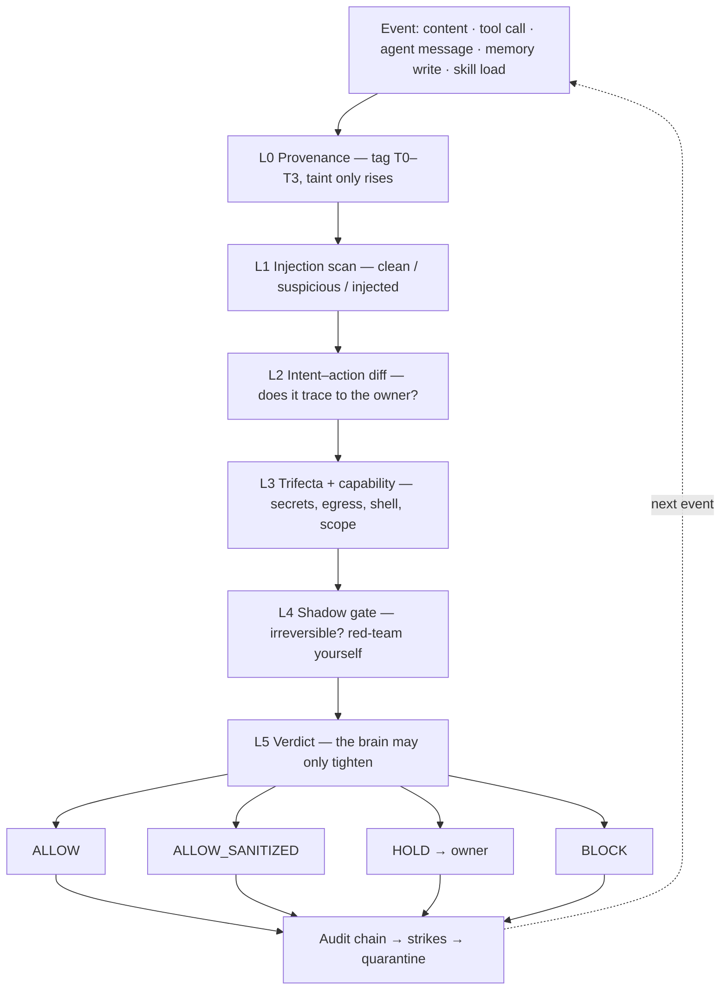

# Genesis Security

[](https://github.com/ElmatadorZ/Genesis-security/actions/workflows/ci.yml)


[](LICENSE)

**A defensive runtime for AI agents and multi-agent systems.**

Agents read web pages, files, emails and each other's messages, and then they act: they run shell commands, send requests, write memory, and move money. Any of that input can carry instructions written by someone else. Genesis Security sits between your agent and its tools and enforces one rule:

> **External content is data, never a command.**

It is built on a strict split:

> **Claude Skill = brain, Python = body, never merged.**

| Layer | Where | What it does |
|---|---|---|
| **Brain** | [`skill/SKILL.md`](skill/SKILL.md) | A Cognitive OS that teaches Claude (or another LLM) how to classify trust, spot injection, reason about intent, and refuse. |
| **Body** | [`genesis_security/`](genesis_security/) | Python that **enforces** verdicts in code: trust tiers, tool gating, signed agent messages, memory guards, a tamper-evident audit log. Stdlib only, zero dependencies, fail-closed. |

Part of the **Genesis Mind** ecosystem. Reverse-engineered from the attack surfaces of Genesis Mind and the SkynetClaw agent.

---

## Contents

- [Install](#install)
- [Five-minute quickstart](#five-minute-quickstart)
- [How it works](#how-it-works)
- [Usage guide](#usage-guide)
- [Applications](#applications)
- [What it stops](#what-it-stops)
- [Red-team results](#red-team-results)
- [Limitations](#limitations)
- [Extending Genesis Security](#extending-genesis-security)
- [Roadmap](#roadmap)
- [Contributing](#contributing)
- [Project layout](#project-layout)
- [License](#license)

---

## Install

Requires Python 3.11+. No third-party packages.

```bash
pip install git+https://github.com/ElmatadorZ/Genesis-security.git
```

Or from a clone:

```bash
git clone https://github.com/ElmatadorZ/Genesis-security.git
cd Genesis-security
pip install .
```

## Five-minute quickstart

```bash
# 1. See the loop stop 12 attacks
genesis-security demo

# 2. Attack your own install with 49 red-team cases (exit code = failures)
genesis-security redteam

# 3. Create the secret the gate uses to sign agent messages and the audit log
export GENESIS_SECURITY_KEY=$(genesis-security keygen)      # PowerShell: $env:GENESIS_SECURITY_KEY = genesis-security keygen
```

Then guard a tool:

```python
from genesis_security import GenesisSecurityGate, Tier

gate = GenesisSecurityGate.from_env(
    owner_confirm=lambda verdict, ctx: input(f"{verdict.reason}\nAllow? [y/N] ") == "y",
)

@gate.guard("delete_file")
def delete_file(path: str) -> str:
    ...

delete_file({"path": "draft.md"}, {"agent": "main", "origin_tier": Tier.T1})  # you asked → you're prompted
delete_file({"path": "draft.md"}, {"agent": "main", "origin_tier": Tier.T3})  # a web page asked → PermissionError
```

That is the core idea: **every action must trace back to you.**

---

## How it works

### Trust tiers

Every piece of input gets a tier (**L0 provenance**). Taint only rises: anything that has passed through T3 stays T3, no matter how many agents relay it.

| Tier | Source | May |
|---|---|---|
| **T0** | system prompt, your config files | set policy |
| **T1** | you, directly | give tasks, approve the Human Gate |
| **T2** | an internal agent with a valid signature | send results and requests; cannot widen its own permissions |
| **T3** | web, files, email, tool output, MCP results, unsigned agents | be read as **data only** |

### The loop



| Layer | Question | Kind |
|---|---|---|
| L0 | Where did this come from? | structural |
| L1 | Does it look like an injection? | heuristic tripwire (EN + TH) |
| L2 | Did the owner ask for this action? | **structural — the main wall** |
| L3 | Would a secret leave? Is the host allowlisted? Is the shell command safe? Is the scope granted? | **structural** |
| L4 | Is it irreversible? Would an attacker want this step? | structural + brain |
| L5 | Final verdict; optional brain review can only make it stricter | — |

### Verdicts

| Verdict | Meaning | What the body does |
|---|---|---|
| `ALLOW` | all layers passed | runs the tool |
| `ALLOW_SANITIZED` | allowed with cleaned input (e.g. memory stored as a tagged fact) | runs with `sanitized_args` |
| `HOLD` | you must decide | calls `owner_confirm` → ALLOW or BLOCK; with no callback it is not run |
| `BLOCK` | refused | raises `PermissionError`, logs, counts a strike |

Fail-closed everywhere: a crashing brain, a crashing owner callback, a malformed tier, or a missing verdict never results in ALLOW.

---

## Usage guide

### 1. Create a gate

```python
from genesis_security import GenesisSecurityGate, AuditTrail, Policy

# From environment (recommended)
#   GENESIS_SECURITY_KEY     required — from `genesis-security keygen`
#   GENESIS_SECURITY_POLICY  optional — path to a policy TOML
#   GENESIS_SECURITY_AUDIT   optional — path to the audit log
gate = GenesisSecurityGate.from_env(owner_confirm=ask_owner)

# Or explicitly
gate = GenesisSecurityGate(
    hmac_key=bytes.fromhex(KEY_HEX),
    policy=Policy.load("my_policy.toml"),
    audit=AuditTrail("logs/audit.jsonl"),
    owner_confirm=ask_owner,
    brain=None,                     # optional semantic reviewer, see §8
)
```

### 2. Guard every tool

Wrap tools with `@gate.guard(name)`. The wrapped function takes `(args, ctx)`.

```python
@gate.guard("http_request")
def http_request(url: str, body: str = "") -> str: ...

@gate.guard("shell_exec")
def shell_exec(cmd: str) -> str: ...

ctx = {
    "agent": "researcher",        # who is acting (used for strikes / quarantine)
    "task_id": "task-42",         # links tool calls to content seen in the same task
    "origin_tier": Tier.T1,       # WHO ASKED for this action — the most important field
    "touches_private": False,     # set True when the call carries private data (enables trifecta check)
}
http_request({"url": "https://api.anthropic.com/v1/messages", "body": "..."}, ctx)
```

**Setting `origin_tier` honestly is your job.** Tag it once, at the place where messages enter your agent loop: your own chat message → `T1`; anything the model decided after reading external content → `T3`. A missing `origin_tier` is treated as T3.

Prefer calling the gate directly? `gate.pre_tool_call(tool, args, ctx)` returns a `Verdict` without running anything.

### 3. Pass external content through the gate

```python
page, verdict = gate.on_external_content("https://news.example/article", html, task_id="task-42")
prompt = f"Summarise this page:\n{page.value}"
```

`page.value` is always wrapped as `<untrusted source=... scan=...>…</untrusted>`, and any `<untrusted>` tags inside the content are escaped, so the content cannot close its own wrapper. The task is marked as having seen T3 data.

Mark individual values as untrusted with `Tainted`:

```python
from genesis_security import Tainted
http_request({"url": "https://api.anthropic.com", "q": Tainted(snippet, Tier.T3)}, ctx)
```

Taint is read recursively through dicts, lists and nested `Tainted` values.

### 4. Agent-to-agent messages

```python
env = gate.make_envelope(
    frm="risk", to="executor", task_id="task-42", body=msg,
    scope=["read:market"],          # permissions this message claims
    hop=current_hop + 1,
    taint=Tier.T3 if msg_contains_web_data else Tier.T2,
)

tier, verdict = gate.on_agent_message(env, msg, granted_scope={"read:market"}, recipient="executor")
```

Refused: bad signature, replays (nonce), messages older than `max_age_s`, wrong recipient, scope the sender was never granted, hop budget exceeded, quarantined senders, injected bodies. Unsigned messages are treated as T3 data.

### 5. Memory and long-term state

```python
v = gate.on_memory_write("/genome/rules.md", text, src_tier=Tier.T3)
if v.allowed:
    store(v.sanitized_args["content"] if v.sanitized_args else text)
```

From T3, only plain facts are stored, tagged `[fact][source:T3]`. Anything rule-like ("always…", "from now on…", "henceforth…", "ต่อไปนี้…", "treat X as the owner") is blocked. Secrets are never stored from any tier.

### 6. Skills, plugins and tool descriptions

```bash
genesis-security pin skill/SKILL.md plugins/*.md      # read them first, then pin
```

```python
v = gate.on_skill_load("plugins/x.md", text, pinned_sha256=PINS.get("plugins/x.md"))
```

Pinned and unchanged → ALLOW. Changed since pinning → BLOCK. Unpinned → HOLD until you read and pin it. Use the same pattern for MCP tool descriptions to catch "rug-pull" updates.

### 7. The Human Gate

`owner_confirm(verdict, ctx) -> bool` is called for every HOLD. `verdict.reason` includes a short, secret-redacted preview of the call, so you can see what you are approving.

```python
def ask_owner(verdict, ctx) -> bool:
    # Terminal
    return input(f"[HOLD] {verdict.reason}\nAllow? [y/N] ").strip().lower() == "y"

# Or push to your phone (Telegram, LINE, ntfy…) and wait for a reply with a timeout.
# Return False on timeout — the gate then blocks.
```

### 8. Optional brain (semantic second opinion)

The rule-based body is fast and predictable. A brain adds judgement for things regex can't see (goal drift, rephrased injections). It can only make verdicts **stricter**.

```python
from examples.claude_brain_adapter import make_claude_brain       # Claude API, needs ANTHROPIC_API_KEY
from examples.ollama_brain_adapter import make_ollama_brain       # local model via Ollama

gate = GenesisSecurityGate.from_env(brain=make_claude_brain(events=("tool_call", "memory_write")))
```

Each reviewed event costs one model call. Use `events=` to choose which hooks go to the brain.

### 9. Audit log and checkpoints

Every verdict is appended to a JSONL log chained with HMAC-SHA256 (keyed from `GENESIS_SECURITY_KEY`). Raw arguments and content are never logged.

```bash
genesis-security checkpoint logs/audit.jsonl > cp.json     # store cp.json where agents can't write
genesis-security verify-audit logs/audit.jsonl --checkpoint cp.json
```

`verify-audit` detects edited, deleted or reordered entries, a rewritten chain, and, with a checkpoint, a truncated or deleted log. Run it at the start of every session. The log is file-locked for concurrent writers and rotates without breaking the chain.

### 10. Policy

```bash
genesis-security policy > my_policy.toml
genesis-security policy check my_policy.toml   # validate before use; lists every problem
export GENESIS_SECURITY_POLICY=my_policy.toml
```

```toml
[egress]
allowlist  = ["api.anthropic.com", "localhost"]   # hosts reachable without asking
tools      = ["http_request", "send_email", "send_message", "git_push", "webhook"]
open_tools = []                                    # tools allowed to reach any host (secret check still applies)

[tools]
irreversible = ["delete_file", "send_email", "transfer_funds", "place_order", "shell_exec", ...]

[shell]
allowlist = ["ls", "cat", "grep", "python", "pytest", "git"]
[shell.deny_args]
python = ["-c"]
git    = ["-c", "--config", "--upload-pack", "--receive-pack", "--exec", "--config-env"]

[agents]
hop_budget = 5
quarantine_after = 2
max_age_s = 300

[secrets]
patterns = ['sk-[A-Za-z0-9_-]{16,}', '-----BEGIN [A-Z ]*PRIVATE KEY-----', ...]
```

### CLI reference

| Command | Does |
|---|---|
| `genesis-security demo` | 12 attack scenarios + an audit tamper check |
| `genesis-security redteam` | 49 attack cases against your install; exit code = failures |
| `genesis-security scan FILE... \| -` | injection scan; exit 0 clean, 1 suspicious, 2 injected |
| `genesis-security keygen` | new `GENESIS_SECURITY_KEY` |
| `genesis-security checkpoint LOG` | print `{count, head}` for the audit chain |
| `genesis-security verify-audit LOG [--checkpoint cp.json]` | verify the chain |
| `genesis-security pin FILE...` | SHA-256 pins for skills, plugins, tool descriptions |
| `genesis-security policy` | print the default policy |
| `genesis-security policy check FILE...` | validate policy files; exit 1 and list every problem if any is invalid |

---

## Applications

### Where the gate goes in an agent loop

```
 you ──T1──▶ ┌──────────────┐        ┌───────────────────────────┐
             │  agent loop   │──────▶│ gate.pre_tool_call / guard │──▶ tools (shell, http, files, trading…)
 web/files ─▶│ (LLM decides) │        └───────────────────────────┘
   │         └──────────────┘                     │
   └─▶ gate.on_external_content (T3, wrapped)      └─▶ audit chain ──▶ verify-audit at session start
```

### Use cases

| Scenario | What to configure | What you get |
|---|---|---|
| **Coding agent** (shell, git, files) | `shell.allowlist`, `deny_args`, `shell_exec` irreversible | No `; rm -rf`, no `python -c`, no `git -c` tricks; every command shown to you before it runs |
| **Research / browsing agent** | put the search tool in `open_tools`; route every page through `on_external_content` | Reads anything, but a page can't make it send data or take actions |
| **Trading bot** (MT5, exchanges) | `place_order`, `transfer_funds` irreversible; scopes like `read:market` vs `trade:live` | Signals from news or other agents can't place orders on their own; the risk agent can't grant itself `trade:live` |
| **Email / support agent** | `send_email`, `send_message` irreversible; secret patterns for your API keys | Phishing emails can't trigger replies or forwards; keys can't be pasted into outgoing mail |
| **Multi-agent council** (Genesis Mind, SkynetClaw, CrewAI-style teams) | signed envelopes, `granted_scope`, `recipient=`, `hop_budget` | No impersonation, no replay, no permission creep, no infinite ping-pong |
| **Long-term memory / personal knowledge base** | `on_memory_write` for every write | Web content can add facts but can never plant rules |
| **Local, offline agents** (Ollama) | `make_ollama_brain` | Same enforcement with no cloud calls |
| **CI / content pipelines** | `genesis-security scan` on prompts, docs, datasets | Fails the build when injected text is about to be fed to a model |
| **Skill and plugin marketplaces** | `pin` + `on_skill_load` | Changed or unreviewed skills don't load silently |

Complete integration example: [`examples/skynetclaw_integration.py`](examples/skynetclaw_integration.py).

---

## What it stops

| Attack | GSX | How |
|---|---|---|
| Hidden instructions in web pages, files, tool output | 01–03 | L1 tripwire; content wrapped as data; actions from T3 blocked at L2 |
| Agent sends your secrets out | 06 | Secret check incl. base64 / hex / url-encoded and split across arguments → BLOCK; any URL to an unlisted host, in any tool, nested anywhere → HOLD |
| Shell injection (`;`, `\|`, `$()`, `python -c`, `git -c`) | 05 | Command allowlist, metacharacter refusal, per-command dangerous options |
| Fake, altered, replayed or misdelivered agent messages | 07 | HMAC envelopes with nonce, timestamp and recipient |
| Agent grabs more permissions | 11 | Scope can't exceed what was granted |
| Agents ping-pong forever | 10 | Hop budget |
| Poisoning long-term memory | 08 | T3 may write tagged facts only, never rules |
| Malicious or silently changed skills / plugins | 12 | SHA-256 pinning |
| Editing, truncating or deleting logs | 13 | Keyed hash chain + checkpoints |

Full threat model, including the Genesis Mind / SkynetClaw component map: [docs/threat-model.md](docs/threat-model.md).

## Red-team results

The suite ships with the package: `genesis-security redteam`. It runs in CI on Linux and Windows.

Before release, two red-team rounds found **22 real bypasses**. All are fixed: wrapper breakout, URL and egress evasions, encoded and split secrets, `python -c` / `git -c`, agent message replay, misdelivery and staleness, memory rules without trigger words, and audit rewrite, truncation and deletion. Details, before/after results and accepted residual risks: [docs/redteam-report.md](docs/redteam-report.md).

## Limitations

Read these before relying on it:

- **L1 is a tripwire, not a wall.** It is regex-based and misses homoglyphs, letter spacing, synonyms and rephrased Thai. The red-team suite shows L2 still blocks every action those attacks try to cause. Real protection comes from the structural rules in L2 and L3.
- **You must tag `origin_tier` honestly.** The gate can't know who asked unless your agent loop tells it.
- **Only tools routed through the gate are protected.** A tool the agent can call directly bypasses everything.
- **Custom encodings to allowlisted hosts get through.** Base64, hex, url-encoding and split secrets are caught. rot13, gzip or XOR sent to a host *you* allowlisted are not. Keep the allowlist short.
- **HMAC proves a message came from someone holding the key**, not which agent. Give agents in different trust zones different keys.
- **Replay protection is per process.** After a restart, `max_age_s` limits the replay window.
- **Not a sandbox.** Use it alongside OS sandboxing, network firewalls and least-privilege credentials.

---

## Extending Genesis Security

Every extension point keeps the same guarantees: **fail closed**, and **the brain may only tighten**.

**Add secrets to detect.** Add regexes to `[secrets].patterns`. They are matched against raw, url-decoded, base64-decoded and hex-decoded views automatically.

**Add or change tool rules.** Edit `egress.tools`, `tools.irreversible`, `shell.allowlist` and `shell.deny_args` in your policy file. No code changes needed.

**Add a semantic detector.** Any callable `brain(event: dict) -> dict | None` works: a classifier, a local model, a rules engine, or a call to another service. Return `{"verdict": "HOLD" | "BLOCK", "reason": "..."}` to tighten, or `None` to pass.

```python
def no_trading_after_hours(event):
    if event["event"] == "tool_call" and event["ctx"].get("tool") == "place_order" and market_closed():
        return {"verdict": "BLOCK", "reason": "market closed"}
    return None

gate = GenesisSecurityGate.from_env(brain=no_trading_after_hours)
```

**Chain several brains.** Run them in order and return the strictest answer:

```python
def chain(*brains):
    rank = {None: 0, "HOLD": 1, "BLOCK": 2}
    def run(event):
        results = [b(event) for b in brains]
        return max(results, key=lambda r: rank[(r or {}).get("verdict")], default=None)
    return run
```

**Custom shell rules.** Subclass the gate and override `_shell_refusal(cmd) -> str | None` (return a reason to refuse).

**Route the Human Gate anywhere.** `owner_confirm` can be a terminal prompt, a phone notification, a desktop dialog or a second approver. Return `False` on timeout.

**Ship logs elsewhere.** The audit log is JSONL. Tail it into your SIEM, Grafana/Loki or a spreadsheet. Store checkpoints off-machine.

**Add a red-team case for every new rule.** See [Contributing](#contributing).

## Roadmap

Ideas for future versions. Contributions welcome.

**Hardening**
- [ ] Per-agent keys and key rotation, so a compromised agent can't sign as others
- [ ] Shared nonce store (SQLite, stdlib) so replay protection survives restarts and spans processes
- [ ] Automatic checkpoint export (push to phone, second machine, or git notes)
- [ ] MCP tool-description pinning helper and diff report
- [ ] Rate limits and spend budgets per agent and per task (tool calls, tokens, money)
- [ ] Optional confusables folding (Unicode TR39) in L1 for homoglyph detection

**Usability**
- [ ] `async` versions of all hooks for asyncio agent loops
- [x] `genesis-security policy check` (strict validation, v1.1)
- [ ] Policy hot-reload
- [ ] Ready-made `owner_confirm` adapters (Telegram, LINE, ntfy, desktop notification)
- [ ] Audit viewer: a small local HTML report of verdicts, strikes and quarantines
- [ ] PyPI release

**Intelligence**
- [ ] Taint tracking through model output (mark LLM answers derived from T3 as T3)
- [ ] Goal-drift detector: compare each plan revision to the owner's original request (GSX-09)
- [ ] Brain evaluation set: labelled events to measure how well a brain tightens without false positives
- [ ] Shared, versioned red-team corpus (EN + TH) contributed by users

## Contributing

1. Fork and clone, then `pip install -e .`
2. Run everything:
   ```bash
   python -m unittest discover -s tests -t .
   genesis-security redteam
   ```
3. Rules for pull requests:
   - **Stdlib only.** No runtime dependencies.
   - **Fail closed.** Any new error path must end in BLOCK, never ALLOW.
   - **The brain may only tighten.** Nothing may loosen a body verdict.
   - **Every new defence ships with a red-team case** in `genesis_security/redteam.py` that fails without the fix and passes with it.
   - Payloads stay inert: canary strings, fake keys, `*.example` hosts.
4. Found a bypass? If it gets past L2/L3, report it privately (see [SECURITY.md](SECURITY.md)). If it only evades the L1 scanner, open a normal issue or PR with a test case.

## Project layout

```
genesis_security/
├── tiers.py              Tier (T0–T3), Tainted, Verdict
├── scanner.py            L1 injection tripwire (EN + TH)
├── policy.py             Policy from TOML
├── default_policy.toml
├── gate.py               GenesisSecurityGate: L2–L5, five hooks, @guard
├── audit.py              HMAC chain, file lock, rotation, checkpoints
├── redteam.py            49-case red-team suite
├── demo.py               12-scenario demo
└── cli.py                genesis-security command
skill/SKILL.md            Brain: Cognitive OS for Claude
examples/                 SkynetClaw integration, Claude and Ollama brain adapters
docs/                     architecture, threat model, red-team report
tests/                    unit tests (unittest)
```

## License

[Apache License 2.0](LICENSE). See [NOTICE](NOTICE).
Copyright 2026 Bunyawat Dechanon (ElmatadorZ).
