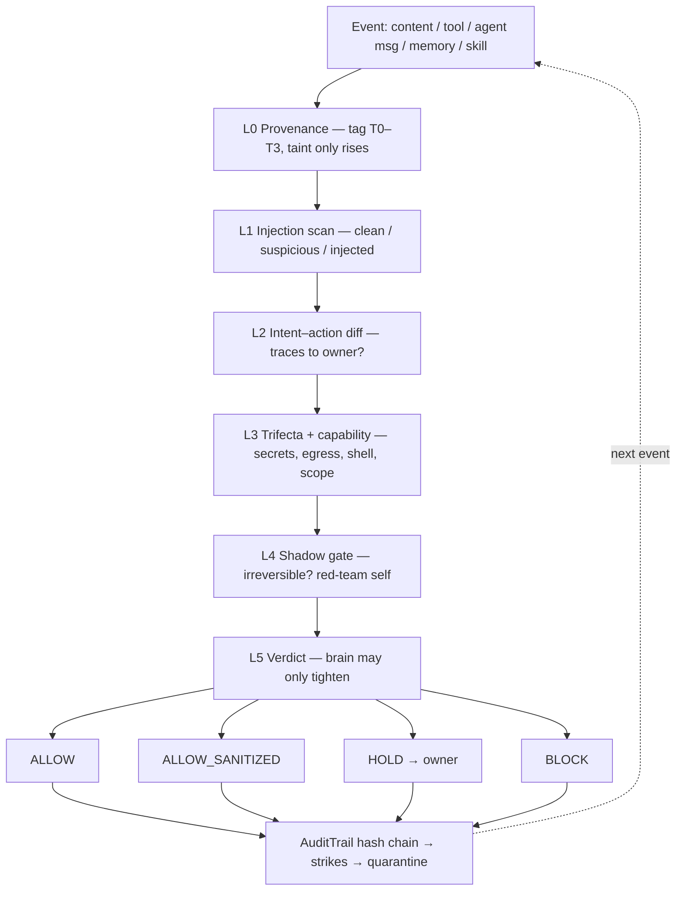

# Genesis Security

[](https://github.com/OWNER/genesis-security/actions/workflows/ci.yml)


[](LICENSE)

**Defensive runtime for AI agents and multi-agent systems.**
ระบบป้องกันการโจมตีจาก AI Agent และ Multi-Agent — แยก "สมอง" (Claude Skill) กับ "ร่างกาย" (Python) ชัดเจน

> Claude Skill = brain, Python = body, never merged.

- **Brain** — [`skill/SKILL.md`](skill/SKILL.md): a Cognitive OS that tells Claude how to classify trust, spot injection, and refuse.
- **Body** — `genesis_security/`: enforces verdicts in code. Stdlib only, zero dependencies, fail-closed.

## Quickstart

```bash
pip install git+https://github.com/OWNER/genesis-security.git
genesis-security demo            # run 12 attack scenarios through the loop
export GENESIS_SECURITY_KEY=$(genesis-security keygen)
```

```python
from genesis_security import GenesisSecurityGate, Tier

gate = GenesisSecurityGate.from_env(owner_confirm=lambda v, ctx: input(f"{v.reason} allow? ") == "y")

@gate.guard("delete_file")
def delete_file(path): ...

delete_file({"path": "x.md"}, {"agent": "main", "origin_tier": Tier.T1})   # → asks owner
delete_file({"path": "x.md"}, {"agent": "main", "origin_tier": Tier.T3})   # → PermissionError
```

Full example: [`examples/skynetclaw_integration.py`](examples/skynetclaw_integration.py)

## The loop



## What it stops

| Attack | GSX | How |
|---|---|---|
| Hidden instructions in web pages, files, tool output | 01–03 | L1 scan + wrapped as `<untrusted>` data; actions from T3 blocked at L2 |
| Agent sends your secrets out | 06 | Secret regex on all egress → BLOCK (S1); unlisted hosts → HOLD |
| Shell injection (`;`, `\|`, backticks) | 05 | Command allowlist + metachar refusal |
| Fake or altered agent messages | 07 | HMAC-signed envelopes |
| Agent grabs more permissions | 11 | Scope can't exceed what was granted |
| Agents ping-pong forever | 10 | Hop budget |
| Poisoning long-term memory / Genome | 08 | T3 may write tagged facts only, never rules |
| Malicious or changed SKILL.md / plugin | 12 | SHA-256 pinning (`genesis-security pin`) |
| Editing the logs afterwards | 13 | Append-only hash chain, file-locked, rotation-safe |

## Hooks

| Hook | Call it when |
|---|---|
| `on_external_content(source, content, task_id)` | anything from outside enters |
| `pre_tool_call(tool, args, ctx)` / `@gate.guard(name)` | before every tool |
| `make_envelope(...)` / `on_agent_message(env, body, granted_scope)` | agent ↔ agent |
| `on_memory_write(path, content, src_tier)` | before memory / genome writes |
| `on_skill_load(path, content, pinned_sha256)` | before loading a skill or plugin |

`ctx["origin_tier"]` is the key field: who actually asked for this action. Missing → treated as T3.

## Configuration

```bash
genesis-security policy > my_policy.toml     # edit allowlists, irreversible tools, budgets
export GENESIS_SECURITY_POLICY=my_policy.toml
export GENESIS_SECURITY_AUDIT=logs/audit.jsonl
```

## CLI

| Command | Does |
|---|---|
| `genesis-security demo` | 12 scenarios + audit tamper check |
| `genesis-security scan FILE...` | injection scan; exit 0 clean / 1 suspicious / 2 injected (use in CI) |
| `genesis-security verify-audit LOG` | verify the hash chain |
| `genesis-security keygen` | new HMAC key |
| `genesis-security pin FILE...` | SHA-256 pins for skills/plugins |
| `genesis-security policy` | print the default policy |

## Optional: Claude as the brain

[`examples/claude_brain_adapter.py`](examples/claude_brain_adapter.py) sends gate events to Claude with `skill/SKILL.md` as the system prompt for a semantic second opinion. It can only make verdicts stricter. Costs one API call per reviewed event.

## Limitations — read this

- **L1 is a tripwire, not a wall.** It is regex-based; a determined attacker can phrase around it. Real protection comes from the structural rules: L2 (actions must trace to the owner) and L3 (egress allowlist, secret blocking, shell allowlist).
- **You must tag `origin_tier` honestly.** The gate can't know who asked unless your agent loop tells it.
- **The gate only protects tools you route through it.** A tool the agent can call directly bypasses everything.
- **HMAC proves a message came from a holder of the key**, not which agent. Give agents in different trust zones different keys.
- Not a replacement for OS sandboxing, network firewalls, or least-privilege credentials. Use it alongside them.

## Development

```bash
python -m unittest discover -s tests -t .
```

## License

Apache License 2.0 — see [LICENSE](LICENSE) and [NOTICE](NOTICE).
Copyright 2026 Bunyawat Dechanon (ElmatadorZ).
