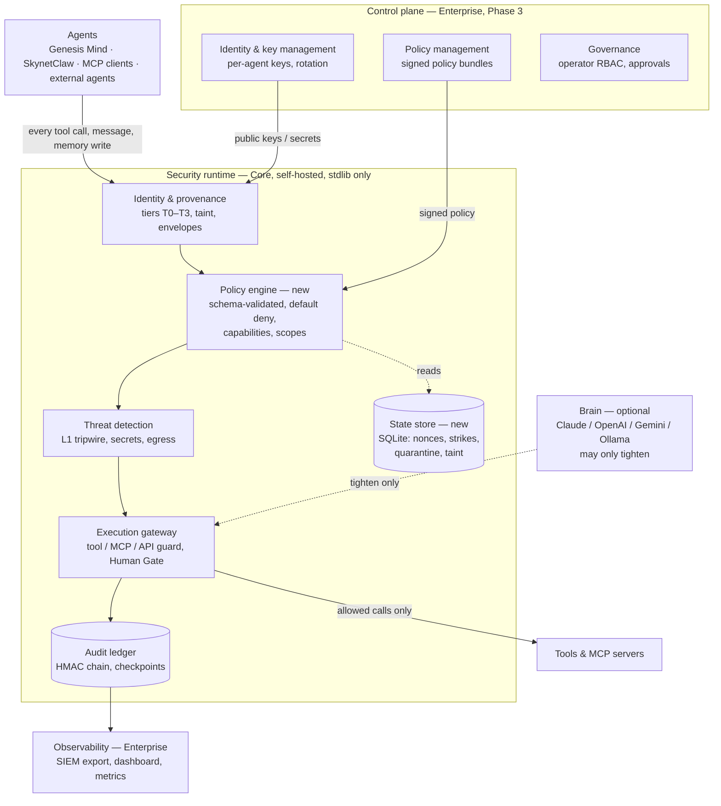

# Architecture — target for Core v2.0

Status: **proposed** (see [ADRs](../adr/)). Today's v1.0 code implements the Runtime box except the parts marked *new*.

## Authority rule

The runtime is the final authority. Agents and brains *propose*; the runtime *decides*. No path exists from model output to a looser verdict, a new scope, a new tier or a policy change (ADR-0001).

## Request path (tool call)

1. **Provenance.** Determine `origin_tier` (from the SDK helper, FR-INT-2) and taint of every argument.
2. **Policy.** Look up the tool. Not declared → BLOCK (default deny). Load capabilities and scopes; check the agent's role allows it.
3. **Detection.** L1 scan of arguments; secret detection on decoded views; destination checks for every network/message capability.
4. **Capability rules.** `exec` → shell rules; `network`/`message` → allowlists; `delete`/`money`/irreversible → Human Gate.
5. **Brain (optional).** May tighten.
6. **Ledger.** Record the verdict. If recording fails → BLOCK.
7. **Gateway.** Run the tool only on ALLOW / ALLOW_SANITIZED (or owner-approved HOLD).

## Boundaries

| Boundary | Trust assumption |
|---|---|
| Runtime ↔ host OS | Runtime trusts the OS; OS isolation (containers, users, network rules) is the integrator's job |
| Runtime ↔ policy | Policy is trusted **only if** it validates (and, when signing is on, verifies) |
| Runtime ↔ agents | Agents are untrusted principals with identities and scopes |
| Runtime ↔ brain | Brain is an untrusted advisor that can only tighten |
| Runtime ↔ ledger readers | Readers can verify integrity with the key; they cannot forge entries without it |

## Deployment shapes

| Shape | When |
|---|---|
| **In-process library** (today) | Single-process agents, SkynetClaw, notebooks |
| **Local sidecar / gateway** (Phase 2, optional) | Agents in other languages; MCP gateway between clients and servers |
| **Central control plane + many runtimes** (Phase 3) | Organizations with fleets of agents |

Cloud-hosted operation is deliberately deferred: it adds cost and attack surface before the core is proven.
