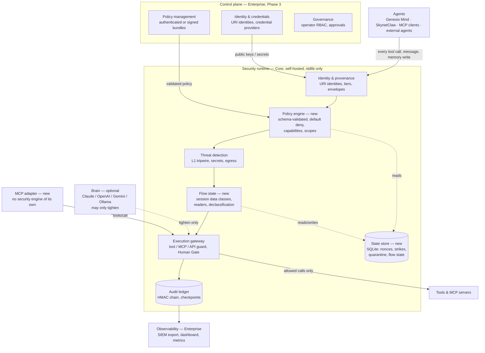

# Architecture — target for Core v2.0

Status: **proposed** (see [ADRs](../adr/)). Today's code implements the Runtime box except the parts marked *new*. Revised 2026-11-25 after architecture review round 2: three enforcement modes on one core; MCP as an adapter of the Execution Gateway; information-flow state (ADR-0009); identity/credential split (ADR-0005).

## Three enforcement modes, one core

| Mode | For | Adds | Shares |
|---|---|---|---|
| **01 · Gate** (default) | Everyone; drop-in | Tool authorization, default-deny, policy enforcement | Security core, identity, policy engine, Execution Gateway, audit ledger |
| **02 · Gate + Flow** (advanced) | Developers handling private data | Session information-flow state, readers = principals and sinks, declassification (ADR-0009) | same |
| **03 · Plan-Constrained** (high assurance) | High-stakes agents (e.g. trading) | Approved plan hash, deterministic executor checking step, transition, arguments, capability (v2.0-beta design) | same |

Rules: one codebase; a mode is a configuration of the same engine, never a fork. The MCP gateway and any other front-end (HTTP sidecar, SDK decorator) **call the same Policy Engine and Execution Gateway**; none has its own security logic.

Plan-Constrained Execution is not called control-flow integrity (CFI) until its properties are proven; human approval of a plan plus an LLM choosing steps is not CFI. It is also not market-risk control: trading deployments still need position and exposure limits, a kill switch and broker-side risk controls.

## Authority rule

The runtime is the final authority. Agents and brains *propose*; the runtime *decides*. No path exists from model output to a looser verdict, a new scope, a new tier or a policy change (ADR-0001).

## Request path (tool call)

1. **Provenance.** Determine `origin_tier` from the authenticated provenance chain (ADR-0003 §4) and the caller's identity (ADR-0005).
2. **Policy.** Look up the tool. Not declared → BLOCK (default deny). Load capabilities and scopes; check the agent's role allows it.
3. **Detection.** L1 scan of arguments; secret detection on decoded views; destination checks for every network/message capability.
4. **Capability rules.** `exec` → shell rules; `network`/`message` → allowlists; `delete`/`money`/irreversible → Human Gate.
4a. **Flow (mode 02+).** If the session has read private data classes, the destination must be one of their readers (ADR-0009); else BLOCK.
4b. **Plan (mode 03).** The call must match the next allowed step of the approved plan; else HOLD/BLOCK.
5. **Brain (optional).** May tighten.
6. **Ledger.** Record the verdict. If recording fails → BLOCK.
7. **Gateway.** Run the tool only on ALLOW / ALLOW_SANITIZED (or owner-approved HOLD).

## Boundaries

| Boundary | Trust assumption |
|---|---|
| Runtime ↔ host OS | Runtime trusts the OS; OS isolation (containers, users, network rules) is the integrator's job |
| Runtime ↔ policy | Policy is trusted **only if** it validates (and, when signing is on, verifies) |
| Runtime ↔ agents | Agents are untrusted principals with URI identities, credentials and scopes |
| Enforcement boundary | Guarantees cover only actions and egress that pass through the Execution Gateway; deployments must route all agent egress through it (ADR-0009 §8) |
| Runtime ↔ brain | Brain is an untrusted advisor that can only tighten |
| Runtime ↔ ledger readers | Readers can verify integrity with the key; they cannot forge entries without it |

## Deployment shapes

| Shape | When |
|---|---|
| **In-process library** (today) | Single-process agents, SkynetClaw, notebooks |
| **Local sidecar / gateway** (Phase 2, optional) | Agents in other languages; MCP gateway between clients and servers |
| **Central control plane + many runtimes** (Phase 3) | Organizations with fleets of agents |

Cloud-hosted operation is deliberately deferred: it adds cost and attack surface before the core is proven.
