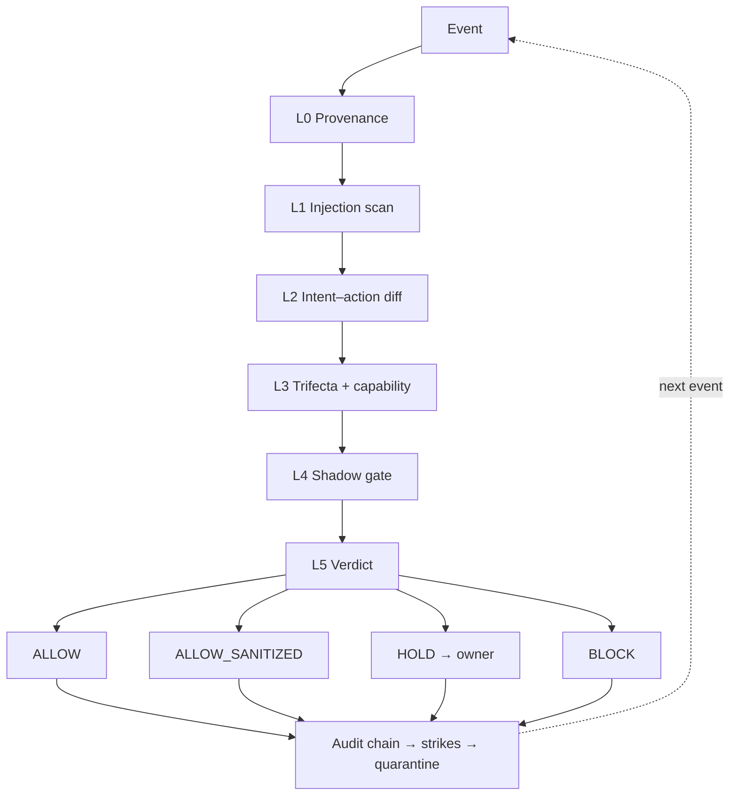

# The Security Loop

Every event passes the same six layers. The layer names follow the Genesis Mind FPCOS pipeline (L0, L1, L4 and L5 cannot be removed).



An event is one of: external content entering, a tool call, an agent-to-agent message, a memory write, or a skill/plugin load.

## L0 — Provenance

Tag everything with a tier ([Trust Tiers and Taint](Trust-Tiers-and-Taint)). Read the action's `origin_tier`, the highest taint in the arguments, and whether the task has seen T3 data. Recorded in the trace as `L0:origin=T1 args=T1 task=T3`.

## L1 — Injection scan *(tripwire)*

`scan_injection(text)` looks for override phrases, role swaps, forged authority (`[SYSTEM]`, "owner approved"), AI-directed instructions, exfiltration requests, audit tampering, urgency pressure, zero-width characters, hidden HTML and long base64 blobs, in English and Thai. Result: `clean`, `suspicious` or `injected`.

L1 is deliberately treated as a **tripwire, not a wall**. It cannot recognise every rephrasing (see [Limitations](Limitations-and-Residual-Risk)). In tool arguments, an `injected` result blocks the call. In external content, the content is still readable, but always wrapped and marked.

## L2 — Intent–action diff *(the main wall)*

> Does this action trace back to the owner?

If `origin_tier` is T3, the call is blocked with `GSX-02, GSX-05`. No pattern matching is involved, so rephrasing doesn't help an attacker.

## L3 — Trifecta and capability

Structural checks on what the call would *do*:

| Check | Result |
|---|---|
| A secret pattern appears in an outbound call, including base64, hex, url-encoded or split across arguments | **BLOCK** (S1) |
| Any URL in any argument, at any depth, in any tool, points to a host not in `egress.allowlist` | **HOLD** |
| A URL is malformed in a way parsers disagree on (backslash, whitespace, `%` in the host) | **HOLD** |
| Outbound call + private data + T3 data in play (lethal trifecta) | **HOLD** |
| Shell command not allowlisted, contains metacharacters, or uses a denied option (`python -c`, `git -c`) | **BLOCK** |
| Agent message claims scope that wasn't granted | **BLOCK** |

## L4 — Shadow gate

"If I were the attacker, what would this step let me do?" In the body this means: is the tool **irreversible** (`tools.irreversible` in policy), or did L3 raise a flag? If so, **HOLD** for the owner. In the brain (`SKILL.md`), the same layer covers judgements regex can't make, such as goal drift.

## L5 — Verdict

Produces `ALLOW`, `ALLOW_SANITIZED`, `HOLD` or `BLOCK`, then:

1. If a **brain** is configured, it reviews the verdict and may make it stricter, never looser. Any brain error → BLOCK.
2. If the verdict is **HOLD** and an `owner_confirm` callback exists, the owner decides → ALLOW or BLOCK.
3. If the verdict is **BLOCK** for an injection class (GSX-01/02/03), the acting agent gets a **strike**. At `quarantine_after` strikes (default 2) it is **quarantined**. Every later tool call or message from it is blocked.
4. The verdict is appended to the **audit chain**, with secrets redacted.

## Reading a trace

Every `Verdict` has `layer_trace`, for example:

```
L0:origin=T1 args=T1 task=T1 → L1:clean → L2:traces to owner → L4:irreversible=True flags=[] → owner:denied
```

Use it to see exactly which layer decided and why.

Next: [Verdicts and the Human Gate](Verdicts-and-the-Human-Gate)
